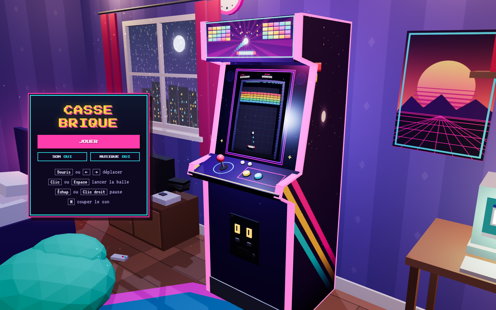
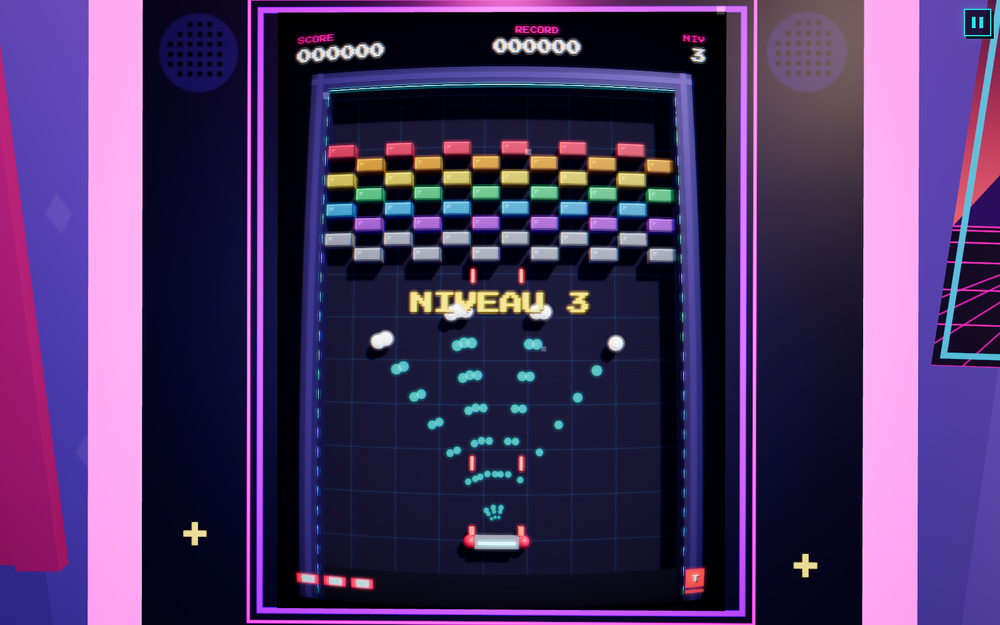

# Casse-brique 3D

Un casse-brique en 3D.

**[Jouer](https://taiyousan-brick-breaker.vercel.app/)**



## Fonctionnalités

- 8 niveaux, briques résistantes, indestructibles et explosives
- 8 bonus et malus : multi-balle, laser, balle perforante…
- Combos jusqu'à ×5
- Démo automatique sur l'écran de la borne au menu
- Jouable à la souris, au clavier et au tactile

## Commandes

| Action   | Souris / clavier       | Tactile          |
| -------- | ---------------------- | ---------------- |
| Déplacer | Souris ou ← →          | Glisser le doigt |
| Lancer   | Clic ou Espace         | Toucher l'écran  |
| Pause    | Échap, P ou clic droit | Bouton pause     |
| Son      | M                      | Menu pause       |



## Organisation du code

```
src/
├─ game/     logique du jeu, sans React ni 3D (simulation, niveaux, bonus, store)
├─ scene/    rendu 3D du jeu
│  └─ arcade/  la chambre, la borne, le shader CRT, la caméra
├─ audio/    moteur Web Audio, bruitages, musique
└─ ui/       menus HTML
```

## Technos

React Three Fiber, Three.js, zustand, Vite, TypeScript.

## Lancer le projet

```bash
npm install
npm run dev
```

Ajouter `#godmode` à l'adresse ouvre un panneau de test : invincibilité, choix du niveau, bonus à volonté.

Polices Press Start 2P et VT323 (SIL OFL).
