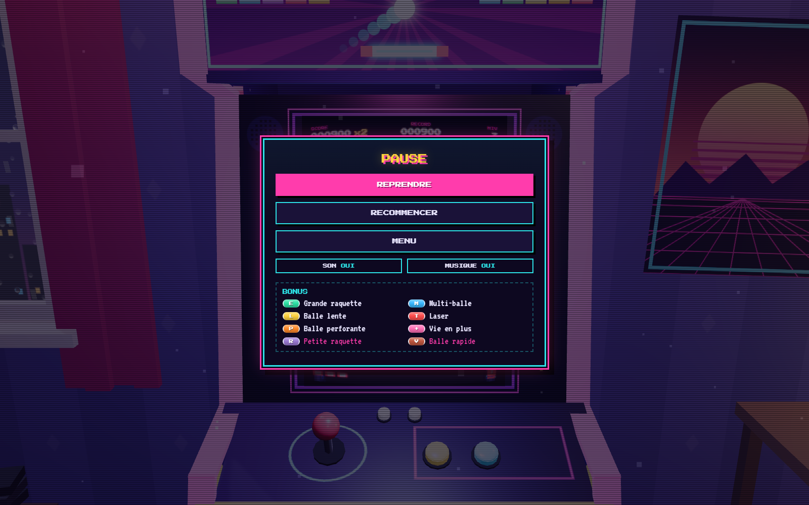
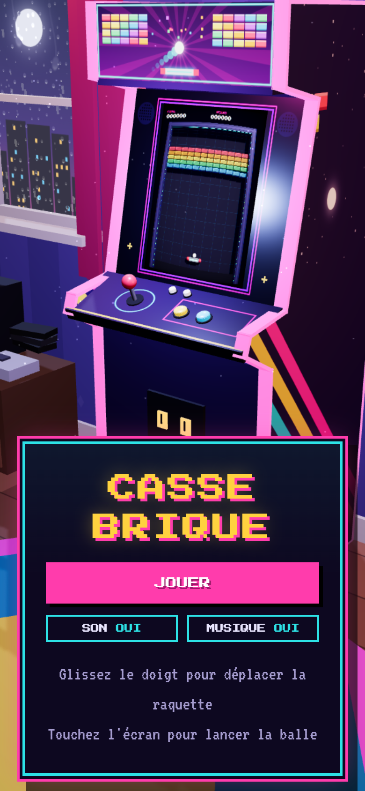

# Casse-brique 3D

Un casse-brique en 3D, joué sur l'écran d'une borne d'arcade, dans une chambre d'ado des années 90.


## Le jeu

- **8 niveaux** de difficulté croissante : briques normales, résistantes (argent), indestructibles (or) et explosives, qui détruisent leurs voisines en chaîne.
- **8 bonus et malus** qui tombent des briques : grande raquette, multi-balle, balle lente, laser automatique, balle perforante, vie en plus… mais aussi petite raquette et balle rapide.
- **Combos** : tant que la balle ne retouche pas la raquette, le multiplicateur de points grimpe jusqu'à ×5, et chaque brique joue une note de plus en plus aiguë.
- **Démo au menu** : comme une vraie borne en attente de joueur, l'écran joue tout seul.
- **Record** conservé dans le navigateur.
- Jouable à la souris, au clavier ou au doigt.


| Pause | Mobile |
|---|---|
|  |  |

### Commandes

| Action | Souris / clavier | Tactile |
|---|---|---|
| Déplacer la raquette | Souris, ou ← → (A/D, Q/D) | Glisser le doigt |
| Lancer la balle | Clic ou Espace | Toucher l'écran |
| Pause | Échap, P ou clic droit | Bouton en haut à droite |
| Couper le son | M | Menu pause |

## Sous le capot

Tout est généré par le code : la chambre, la borne, les textures, les sons. Le projet ne charge **aucune image, aucun modèle 3D et aucun fichier audio**, seulement deux polices pixel.

- **Un jeu dans le jeu.** Le casse-brique est rendu dans une texture hors écran, avec sa propre caméra, puis affiché sur l'écran de la borne par un shader qui imite un tube cathodique : bombé, lignes de balayage, halo, aberration chromatique. Le pointeur est projeté sur l'écran de la borne, corrigé de la même courbure que le shader, puis reprojeté dans le jeu : la raquette tombe exactement sous le curseur.
- **Physique maison**, à pas de temps fixe (240 Hz) et sous-pas : la balle ne traverse jamais une brique, même à grande vitesse, et le jeu se comporte pareil à 60 ou à 144 images par seconde. Pas de moteur physique : un casse-brique a besoin de rebonds précis et contrôlables (angle selon le point d'impact sur la raquette), pas réalistes.
- **Simulation découplée de React.** L'état rapide (balles, briques, particules) vit dans un objet modifié à chaque pas et lu directement par les composants 3D. L'état lent (score, vies, écran affiché) est dans un store [zustand](https://github.com/pmndrs/zustand). React ne refait presque jamais de rendu pendant la partie.
- **Événements.** La simulation émet des événements (brique détruite, rebond, bonus ramassé…). Les effets visuels et sonores s'y abonnent sans toucher à la logique du jeu.
- **Performances.**
  - Le mur de briques, les particules et les traînées utilisent des `InstancedMesh` : un appel de dessin pour des centaines d'objets, et des réserves fixes, sans allocation pendant la partie.
  - Les shaders des objets qui n'apparaissent qu'en cours de jeu sont compilés dès le chargement.
  - La résolution s'adapte en continu à la puissance de l'appareil.
  - Le HUD dans l'écran est découpé en petits calques, redessinés seulement quand leur contenu change.
- **Sons synthétisés** avec la Web Audio API : bruitages 8 bits, gamme pentatonique pour les combos, jingles et boucle de musique chiptune, programmés sur l'horloge audio. Au menu, ils sont filtrés comme s'ils sortaient du haut-parleur de la borne.
- **Effets** : éclats en voxels, tremblement et flash de l'image, micro-arrêt sur les explosions, points flottants, pluie sur la fenêtre (shader de gouttes qui déforment la vue), lumière de l'écran qui pulse dans la chambre au rythme des casses.

### Technologies

[React 19](https://react.dev) · [Three.js](https://threejs.org) · [React Three Fiber](https://r3f.docs.pmnd.rs) · [drei](https://github.com/pmndrs/drei) · [zustand](https://github.com/pmndrs/zustand) · [Vite](https://vite.dev) · TypeScript

### Organisation du code

```
src/
├─ game/            logique du jeu, sans React ni 3D
│  ├─ simulation.ts   physique, collisions, bonus
│  ├─ world.ts        état rapide de la simulation
│  ├─ store.ts        état lent : score, vies, écran affiché
│  ├─ levels.ts       les niveaux, décrits en texte
│  ├─ powerups.ts     définition des bonus
│  ├─ demo.ts         IA de la démo du menu
│  └─ cheats.ts       god mode
├─ scene/           rendu 3D du jeu (dans l'écran de la borne)
│  └─ arcade/         la chambre, la borne, le shader CRT, la caméra
├─ audio/           moteur Web Audio, bruitages, musique
└─ ui/              menus et panneaux HTML
```

## Lancer le projet

Il faut [Node.js](https://nodejs.org) 20.19 ou plus récent.

```bash
npm install
npm run dev       # serveur de développement sur http://localhost:5173
npm run build     # version de production dans dist/
npm run preview   # sert la version de production
```

### Pour tester

- **God mode** : ajouter `#godmode` à l'adresse (`http://localhost:5173/#godmode`) affiche un panneau de test : mort impossible, saut de niveau, bonus à volonté, vitesse du jeu, taux de chute des bonus. Les parties jouées ainsi n'enregistrent pas de record.
- **Commencer à un niveau** : `?niveau=5` dans l'adresse, puis Jouer.

### Ajouter un niveau

Les niveaux sont des grilles de 12 caractères par ligne, dans [`src/game/levels.ts`](src/game/levels.ts) :

```ts
[
  'rrrrrrrrrrrr', // r o y g b p : briques normales (couleur)
  'oooo*oo*oooo', // * : explosive
  '#3333333333#', // 2 3 : résistantes (coups nécessaires), # : indestructible
  'gg..gggg..gg', // . : vide
]
```

## Crédits

Polices [Press Start 2P](https://fonts.google.com/specimen/Press+Start+2P) (CodeMan38) et [VT323](https://fonts.google.com/specimen/VT323) (Peter Hull), sous licence SIL Open Font License.
